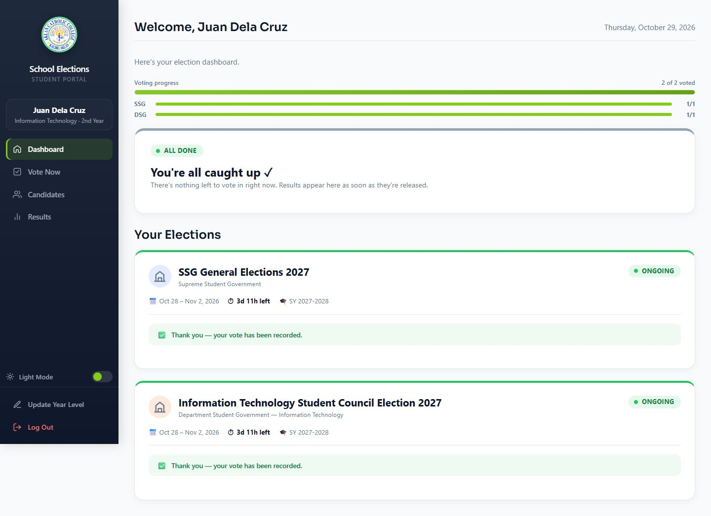
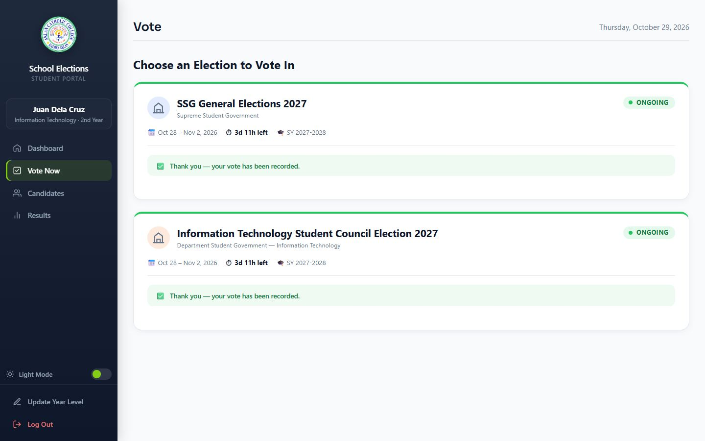
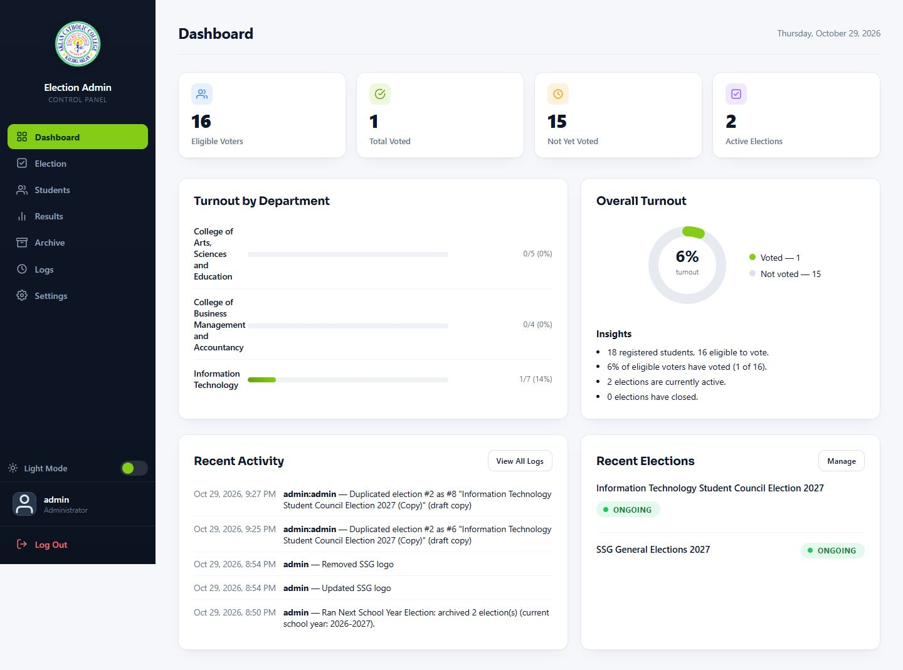

# School Voting System

A secure, self-hosted voting platform for **SSG (Student Supreme Government)** and **DSG (Department Student Government)** school elections — built in plain PHP with no framework, no build step, and no Composer dependencies.

| Student portal | Ballot | Admin panel |
|---|---|---|
|  |  |  |

## Highlights

- **Complete election lifecycle** — draft → scheduled → ongoing ⇄ paused → closed → archived, with lazy status sync (no cron needed) and a one-SSG-per-school-year / one-DSG-per-faculty rule enforced at the database level.
- **Real ballots** — single-choice and capped multi-select positions, abstention by skipping, per-election drafts, an explicit confirmation step, and one-time participation locks (`ballot_submissions`).
- **Live results** — auto-refreshing public/student results with percentages, bars, tie-aware "Leading" badges, and per-election visibility rules (`always` / `after close` / `never`) enforced server-side.
- **Ballot secrecy by design** — vote content is stored anonymously; administrators can see participation, never selections.
- **School-year engine** — year levels derived from student IDs, a June 1 cutover, and a guided "Next School Year" rollover.
- **A built-in guided tour** — the [`guide/`](guide/) app is an interactive, 17-chapter walkthrough of the entire codebase with a defense-kit Q&A per screen.

## Security

| Control | Implementation |
|---|---|
| Passwords | bcrypt + automatic rehashing, policy ≥ 8 chars with letter + digit |
| CSRF | Per-session token verified on every POST (form field or JSON body), timing-safe comparison |
| Rate limiting | Per-bucket limits: register 5/600s · logins 8/300s · votes 10/60s · drafts 60/60s · admin writes 120/60s |
| Sessions | Hardened cookies (HttpOnly, SameSite=Lax, Secure on HTTPS), `session_regenerate_id` on login |
| Headers | CSP, X-Frame-Options, Referrer-Policy, X-Content-Type-Options, HSTS (Apache + router) |
| Uploads | Strict image validation (JPEG/PNG/GIF/WebP, 1–5000px, ≤ 2MB, SVG rejected) |
| SQL | PDO prepared statements exclusively |

## Tech stack

| Layer | Choice |
|---|---|
| Backend | PHP 8.3, no framework |
| Database | Dual-driver via PDO: MariaDB 10.4 (local) **or** PostgreSQL / Neon (production) — selected by `DATABASE_URL` |
| Frontend | Vanilla JS SPA-style panels, no build step |
| Libraries | Chart.js 4.4.1, SheetJS 0.18.5 — CDN with pinned SRI hashes |
| Hosting | Docker (`php:8.3-cli`) on Render; Neon serverless Postgres |
| CI/CD | GitHub Actions: lint + schema parity + JS parse (`ci.yml`), weekly `pg_dump` backups (`db-backup.yml`), 15-min uptime probe (`uptime.yml`) |

## Quick start (local)

Requires [XAMPP](https://www.apachefriends.org/) (PHP 8.2/8.3 + MySQL) and Git.

```powershell
# 1. Clone into your XAMPP htdocs
cd C:\xampp\htdocs
git clone https://github.com/<your-account>/voting-app3.git
cd voting-app3

# 2. Create and seed the database
mysql -u root voting_app < database\schema.mysql.sql

# 3. Verify the environment (extensions, tables, seeded accounts)
powershell -ExecutionPolicy Bypass -File tests\verify-local-env.ps1
```

Then open <http://localhost/voting-app3/public/landingpage.php> and log in with the seeded demo accounts:

| Role | ID / username | Password |
|---|---|---|
| Student | `987654321` | `password123` |
| Admin | `admin` | `admin123` |

> Demo credentials are for local development only — change them in any real deployment.

## The guided tour

The [`guide/`](guide/) directory contains an interactive documentation app — 17 chapters covering every screen of the system, with code references that stay anchored to the live source and a "defense kit" of short and deep security answers per topic.

- Browse at <http://localhost/voting-app3/guide/>
- Verify its integrity: `bash guide/tools/test.sh` · `node guide/tools/qa.mjs`
- Regenerate its screenshots after UI changes: `node guide/tools/capture.mjs`

## Documentation

Full documentation set lives in [`docs/`](docs/) as Word documents (each with a cover page and table of contents):

| # | Document |
|---|---|
| 01 | Software Requirements Specification |
| 02 | Hardware and Software Requirements |
| 03 | System Design Specification (with architecture, DFD, ERD, sequence and activity diagrams) |
| 04 | Database Design and Data Dictionary |
| 05 | Technical and API Documentation |
| 06 | Security Plan and Threat Model |
| 07 | Software Test Plan and Results |
| 08 | Deployment and Operations Guide |
| 09 | Student User Manual |
| 10 | Administrator Manual |
| 11 | Maintenance, FAQ and Handover |

## Testing

```powershell
# Full HTTP smoke suite — 34 sections, leave-DB-as-found (requires local server + DB)
powershell -ExecutionPolicy Bypass -File tests\http_smoke.ps1

# MySQL vs PostgreSQL schema parity
php tests\schema_parity.php

# Pre-flight environment check
powershell -ExecutionPolicy Bypass -File tests\verify-local-env.ps1
```

Latest run: **445 PASS / 0 FAIL** across all 34 sections. See [docs/07](docs/07%20-%20Software%20Test%20Plan%20and%20Results.docx) for the suite catalog, performance baselines, and UAT scripts.

## Deployment

Production runs as a Docker container (`php:8.3-cli`) on **Render**, fronting a **Neon** serverless PostgreSQL via `DATABASE_URL` (`sslmode=require`). GitHub Actions handles CI, weekly database backups, and a 15-minute health probe against [`public/health.php`](public/health.php). Full runbook: [docs/08 - Deployment and Operations Guide](docs/08%20-%20Deployment%20and%20Operations%20Guide.docx).

## Project structure

```text
voting-app3/
├── public/      Landing page, public results, health endpoint
├── student/     Login, register, dashboard panels, ballot + vote API
├── admin/       Admin dashboard (7 panels) and per-panel JSON APIs
├── includes/    Shared function kit (28 helpers)
├── config/      Dual-driver DB bootstrap, PHP built-in server router
├── database/    Schema + ordered migrations (MySQL and PostgreSQL)
├── tests/       HTTP smoke suite, schema parity, env verifier
├── tools/       Backup script (pg_dump wrapper)
├── guide/       Interactive guided tour of the codebase
└── docs/        Documentation set (Word) + design screenshots
```
